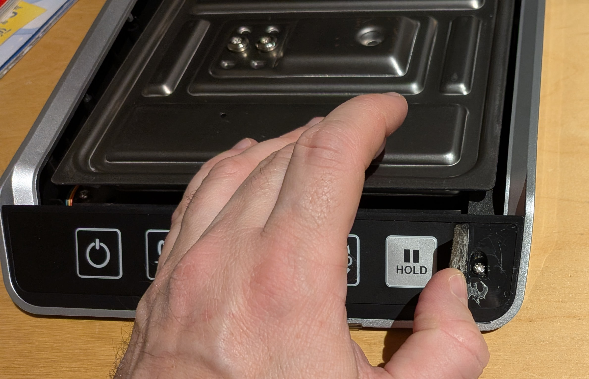
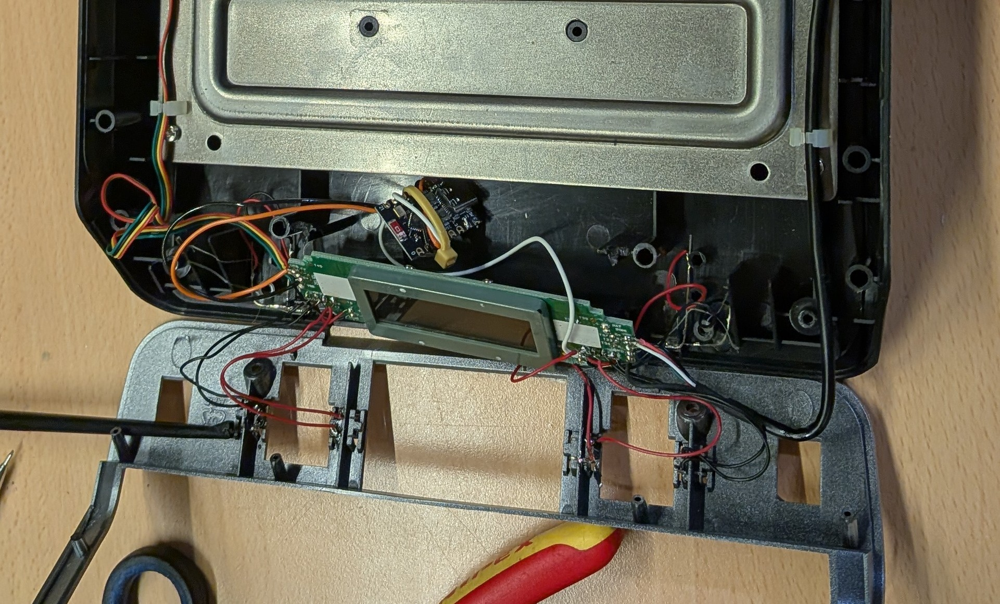

# Modified DYMO Scale to prevent Power off
Goal of this repo is to show how to modify the DYMO M10 scale so it does not switch off by itself.
By default, it switches off after 3 minutes of no actions. To prevent this, a button (eg. the units selector) can be pressed.
This repo shows how to add a simple microcontroller to toggle the units button twice per minute to prevent power off.

## Dismantling the Scale
You will need to open the case of the scale. Follow the great tutorial at https://learn.adafruit.com/data-logging-iot-weight-scale/assembly to do so. Note that my scale needed an additional step to **remove the front faceplate from the scale**:
You will need to lift the glued on front lable to access two additional screws:

## Adding the microcontroller
I picked the units toggle button as pressing it has no impact on the scale's functionality. The inpout pin of the button is connected to the microcontroller via a wire.

## Firmware
The `firmware/` directory contains a PlatformIO project for a Tenstar ESP32-C3 Super Mini. Any other ESP32-based microcontroller should work as well.
It simulates presses on the units button: **GPIO3** pulls the button line low for 300 ms twice in a row (600 ms apart) every 2.5 minutes, and stays hi-Z the rest of the time (open-drain, never driven high), so the real button keeps working in parallel.

### Wiring
- GPIO3 → units button pad (the side that gets pulled low when pressed)
- GND → scale ground

See [`firmware/README.md`](firmware/README.md) for build/flash instructions and timing configuration.

## Websocket
See https://github.com/caco3/Dymo-scale-websocket for a websocket server that can be used to read the scale data and provide it through Ethernet.
